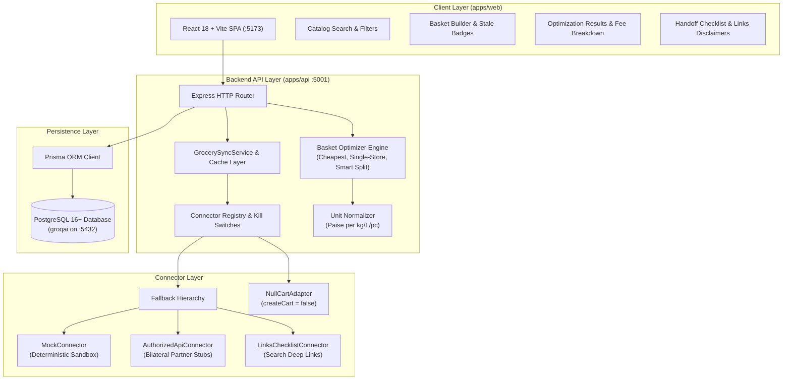

# GrocAI Phase 0 Baseline Audit & Reproducibility Runbook

**Document Status:** Approved Baseline  
**Commit SHA:** `81eba0e28718bb516c4b129b22dbafe620500d34`  
**Git Tag:** `baseline-working-demo`  
**Branch:** `chore/phase-0-baseline`  
**Date:** November 2026  
**Auditor:** GrocAI Core Engineering  

---

## 1. Executive Summary

Phase 0 establishes a frozen, verifiable baseline for **GrocAI**—an autonomous, deterministic grocery price comparison and basket optimizer for Indian quick-commerce platforms (**Blinkit, Zepto, Swiggy Instamart, BigBasket**).

Before building production data pipelines or web scrapers, this baseline guarantees:
1. **Clean Code & Git History:** Baseline code committed and tagged at `baseline-working-demo`.
2. **Deterministic Architecture:** Exact integer paise financial math, unit normalizations (₹/kg, ₹/L), and fee-aware multi-store basket splitting.
3. **Honest Capability Boundaries:** Simulated catalog mode labeled explicitly; automated cart creation (`createCart`) disabled via `NullCartAdapter`; zero credential collection; checkout handoff via verified search links and checklists.
4. **Reproducible Environment:** Verified across Node.js v26+, PostgreSQL 16+, Prisma ORM, and Vitest test runners (75 passing tests).

---

## 2. System Architecture

The monorepo is organized using npm workspaces across three packages:
- `packages/shared`: Shared types, Zod schemas, integer paise money utilities, freshness TTLs, and unit normalizers.
- `apps/api`: Express.js backend, Prisma ORM, connector registry, optimizer engine, fallback hierarchies, and sync service.
- `apps/web`: React 18, Vite, Tailwind CSS, Lucide icons, and honest client-side state management.



---

## 3. What is Real vs. What is Mock

| Component / Subsystem | Status | Details |
| :--- | :--- | :--- |
| **Optimization Engine** | **REAL** | Deterministic integer math comparing Single-Store, Raw Item-by-Item, and Smart Split against variable delivery, platform, and surge fees. |
| **Unit Normalization** | **REAL** | `calculateNormalizedUnitPrice` parses grams, kilograms, milliliters, liters, and pieces, converting all prices to paise per base unit. |
| **Financial Integrity** | **REAL** | Strict integer paise representation across DB, API, optimizer, and UI. No floating-point rounding errors for currency. |
| **Resilience & Governance** | **REAL** | Circuit breaker state machine (CLOSED, OPEN, HALF-OPEN), immediate platform kill switches, exponential backoff with jitter. |
| **Compliance & Disclaimers** | **REAL** | `NullCartAdapter` explicitly returns `createCart: false`. Disclaimers and checklists enforce merchant-app final payment. |
| **Database Persistence** | **REAL** | PostgreSQL schema with Prisma ORM: `Product`, `Category`, `PlatformListing`, `PriceObservation`, and `PlatformFeeRule`. |
| **Platform Connectors** | **MOCK** | `BlinkitAdapter`, `ZeptoAdapter`, `InstamartAdapter`, and `BigBasketAdapter` run in `mock` mode with static observations. |
| **Cart Creation** | **INTENTIONALLY DISABLED** | Automated browser checkout / bot cart injection is prohibited. No automated OTP or payment interaction. |
| **Live Web Scraping** | **NOT IMPLEMENTED** | No production live scraping code is deployed. Feasibility spike is isolated in Phase 0. |

---

## 4. Known Gaps in Current Baseline

The following architectural and implementation gaps are intentionally logged for remediation in subsequent phases:

1. **`PlaywrightAssistedConnector` is a stub:**
   Currently logs a security warning and falls back to `LinksChecklistConnector`. Does not yet execute interactive browser sessions.
2. **`syncProduct` uses `observations[0]` instead of the matcher:**
   In `GrocerySyncService`, the adapter result is mapped directly from the first returned observation rather than running `MatchingService.matchProduct()`.
3. **`server.ts` and `syncBasketItems` fallback to `allProducts[0]`:**
   When an exact match is missing during manual sync simulation, the server falls back to the first available product in the database.
4. **`PriceObservation` schema lacks the full 14 fields:**
   Prisma model `PriceObservation` contains basic price, stock, and source fields, but lacks explicit columns for all 14 telemetry fields (e.g. `normalizedPricePaise`, `packUnit`, `confidenceScore`, `verificationStatus`) which are currently computed at runtime in API responses.
5. **Fee rules are hardcoded, then overlaid from DB:**
   Default fee structures (delivery, platform fee, surge thresholds) exist in `constants.ts` before being overlaid by `PlatformFeeRule` records.
6. **No background worker:**
   Background queueing (e.g., BullMQ with Redis) is stubbed. Synchronization is on-demand via HTTP endpoints (`/api/products/:id/refresh`, `/api/products/sync`).
7. **`ExternalAIProviderParser` is a stub:**
   `AI_PROVIDER=none` by default. Natural language grocery list parsing returns fallback token matches.

---

## 5. Environment Quirks & Configuration

- **Node.js Version:** Verified on **Node.js v26.5.0** (compatible with Node 20+ requirement).
- **PostgreSQL Authentication:** Local macOS PostgreSQL daemon running on default port `5432` connecting as user `arnavyadav` with database `groqai` (zero password over Unix socket/localhost).
- **Port Allocation:**
  - Express API: `http://localhost:5001`
  - Vite Frontend: `http://localhost:5173`
  - PostgreSQL: `localhost:5432`
- **Environment Files:**
  - `.env` (monorepo root)
  - `apps/api/.env`
  - `apps/web/.env`

Required environment variables:
```env
DATABASE_URL=postgresql://arnavyadav@localhost:5432/groqai
API_PORT=5001
WEB_ORIGIN=http://localhost:5173
VITE_API_BASE_URL=http://localhost:5001
BLINKIT_INTEGRATION_MODE=mock
ZEPTO_INTEGRATION_MODE=mock
INSTAMART_INTEGRATION_MODE=mock
BIGBASKET_INTEGRATION_MODE=mock
PLAYWRIGHT_ENABLED=false
```

---

## 6. Reproducibility Runbook

To reproduce this verified baseline from scratch on any development machine:

### Step 1: Clone and Checkout Baseline
```bash
git clone https://github.com/arnavyadav/GroqAI.git
cd GroqAI
git checkout baseline-working-demo
```

### Step 2: Install Dependencies
```bash
npm install
```

### Step 3: Configure Database
Ensure PostgreSQL is running locally on port 5432:
```bash
pg_isready
createdb groqai
npm run db:push --workspace=apps/api
npm run db:seed --workspace=apps/api
```

Verify seeded table records:
```bash
psql -d groqai -Atc "
select 'categories='||count(*) from \"Category\"
union all select 'products='||count(*) from \"Product\"
union all select 'listings='||count(*) from \"PlatformListing\"
union all select 'fee_rules='||count(*) from \"PlatformFeeRule\";"
```
*Expected Output:*
```
categories=10
products=45
listings=180
fee_rules=4
```

### Step 4: Run Quality Gate
```bash
npm run typecheck
npm run lint
npm test
npm run build
```
*Expected Output:*
- Typecheck: 0 errors across `@groqai/shared`, `@groqai/web`, and `@groqai/api`.
- Lint: 0 lint errors.
- Tests: 75 tests passing (12 shared + 7 web + 56 api).
- Build: Vite production build and TypeScript build exit 0.

### Step 5: Start Development Servers
```bash
# Terminal 1: API Server
npm run dev:api

# Terminal 2: Web Client
npm run dev:web
```

### Step 6: Smoke Test Endpoints
```bash
curl -s http://localhost:5001/api/health | jq
curl -s "http://localhost:5001/api/products/search?q=amul" | jq '.[0]'
curl -s http://localhost:5001/api/platforms | jq
curl -s http://localhost:5001/api/sync/status | jq
```

Open `http://localhost:5173` in a browser. Search for `Amul milk`, add items to the cart, run optimization, and proceed to the checklist handoff. Confirm all platform prices show `MOCK` and disclaimers are present.
